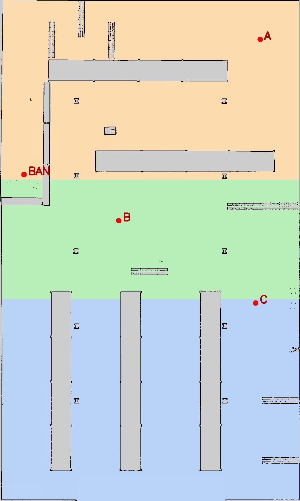

# Bài thực hành 7 — Phân vùng bản đồ và điều hướng bằng giọng nói

Môi trường: Ubuntu 22.04, ROS 2 Humble, TurtleBot 4 Simulation.

Bài nộp: [source nhánh assignments_7](https://github.com/ducduy1011/TuongTacNguoi_Robot/tree/assignments_7). GitHub chứa mã nguồn, bản đồ và cấu hình cần chạy; báo cáo PDF nộp riêng và video do sinh viên tự tải lên [Google Drive](https://drive.google.com/drive/folders/1fgSjUEJVbLln_qFV6CG24UOq2GFeI8SX?usp=sharing), giữ liên kết của mẫu.

Luồng xử lý: **Micro → Vosk tiếng Việt → `/voice_command` → phân tích câu → Nav2 `NavigateToPose`**.

## 1. Cách thực hiện

- Dùng bản đồ có sẵn `warehouse` của TurtleBot 4. Đề bài không yêu cầu tạo lại bản đồ bằng SLAM.
- Chia thủ công thành 3 vùng bằng đa giác trong `config/zones.yaml`, đúng phương án đề cho phép. Đây là phân vùng chức năng do người dùng đặt, không phải tự động nhận dạng phòng.
- OpenCV dùng ngưỡng của `map.yaml` để lấy ô trống; loại ô vật cản và ô chưa biết. Trong mỗi vùng, chọn ô cách vật cản xa nhất, có khoảng trống tối thiểu 0,35 m và cách ranh giới vùng ít nhất 0,35 m.
- Lưu tên, ID, tọa độ đích vào `output/regions.yaml`. Nav2 lập đường đi và tránh vật cản dựa trên bản đồ, lidar và costmap.
- Lệnh từ A đến B luôn gửi đích A trước; chỉ gửi B khi action A có trạng thái `SUCCEEDED` và tọa độ robot xác nhận đã đến gần đích (sai số tối đa 0,4 m, dữ liệu tọa độ không quá 2 giây). Nếu đích bị từ chối, điều hướng thất bại hoặc chưa xác nhận được vị trí, dừng lộ trình. Khi đang di chuyển, thông báo bận nếu có lệnh mới.

| ID | Tên vùng | Đích x, y (m) |
|---|---|---|
| A | Khu nhận hàng | 11,075; 21,275 |
| B | Hành lang | −3,145; 3,095 |
| C | Khu lưu trữ | 10,625; −5,155 |
| BAN | Gần bàn (điểm đến bổ sung) | −12,685; 7,715 |

Điểm `BAN` nằm trên sàn trống, cách tâm bàn khoảng 1,2 m và quay về phía bàn. Khai báo trong `waypoints` của `config/zones.yaml`; khi tạo lại bản đồ, chương trình kiểm tra khoảng trống cho điểm này như các đích A/B/C.



Đổi pixel `(u,v)` sang mét, với `h` là chiều cao ảnh, `r` là resolution:

```text
px = (u + 0.5) * r
py = (h - v - 0.5) * r
x = origin_x + px*cos(yaw) - py*sin(yaw)
y = origin_y + px*sin(yaw) + py*cos(yaw)
```

`yaw` lấy từ `origin[2]` trong map YAML. Cộng 0,5 để chọn tâm ô; đảo chiều v vì gốc ảnh nằm phía trên. Hướng đích đặt bằng 0 rad trong hệ `map`.

## 2. Cài đặt và biên dịch

Giả sử đã cài TurtleBot 4 Simulation cho Humble. Chạy tại thư mục bài:

```bash
cd /home/duy/bai7
sudo apt update
sudo apt install -y python3-colcon-common-extensions python3-pip \
  python3-opencv python3-numpy python3-yaml python3-pytest \
  libportaudio2 unzip curl ros-humble-nav2-msgs
python3 -m pip install --user -r requirements.txt
sudo apt install --only-upgrade ros-humble-tf2 ros-humble-tf2-ros
source /opt/ros/humble/setup.bash
PYTHONNOUSERSITE=1 colcon build --symlink-install --packages-select voice_navigation
source install/setup.bash
ros2 run voice_navigation segment_map \
  --map maps/warehouse.yaml --zones config/zones.yaml --output output
```

`PYTHONNOUSERSITE=1` chỉ dùng lúc build để tránh xung đột setuptools của máy; khi chạy speech cần dùng các thư viện pip đã cài cho người dùng.

Máy này có `tf2_ros` 0.25.23 bị treo khi chờ tọa độ, ảnh hưởng RViz và Nav2. Cần cập nhật lên 0.25.24 trở lên rồi tắt/mở lại các node để dùng thư viện mới. Bản sửa được ghi trong [changelog chính thức của tf2_ros](https://github.com/ros2/geometry2/blob/humble/tf2_ros/CHANGELOG.rst). Chỉ chạy một bộ node giọng nói tại một thời điểm để tránh gửi đích trùng.

Tải và giải nén model nhận dạng tiếng Việt (cần mạng khi tải, nhận dạng chạy offline):

```bash
mkdir -p models
curl -fL https://alphacephei.com/vosk/models/vosk-model-small-vn-0.4.zip \
  -o models/vosk-model-small-vn-0.4.zip
unzip -q -o models/vosk-model-small-vn-0.4.zip -d models
```

## 3. Chạy hệ thống

Trong **mỗi terminal**, chạy trước:

```bash
cd /home/duy/bai7
source /opt/ros/humble/setup.bash
source install/setup.bash
```

**Terminal 1 — mô phỏng:**

```bash
bash /home/duy/bai7/run_sim.sh
```

Script dùng `launch/simulation.launch.py` để chạy server và giao diện Gazebo riêng, tránh kẹt ở bước `starting_world`. World `worlds/warehouse.sdf` dùng các mô hình đã có trong cache trên máy này, tránh chờ tải Internet. Bản world bỏ riêng người trang trí `Casual female` chưa tải được; giữ nhà kho, kệ và các vật cản còn lại. Khi chuyển máy cần chuẩn bị lại đường dẫn các mô hình cục bộ. Khi dừng, dùng `Ctrl+C` tại terminal chạy script và đợi các tiến trình thoát trước khi mở lại.

World đặt hệ thống Sensors dùng **Ogre2**. Trên máy này, Ogre cũ làm toàn bộ 640 tia lidar trả về 0,164 m, gây sai định vị và vật cản giả; không thể khắc phục chỉ bằng đổi điểm đích. Sau khi sửa, laser phải đo được các khoảng cách khác nhau tới tường, kệ (xem [báo cáo lỗi tương tự của TurtleBot 4](https://github.com/turtlebot/turtlebot4/issues/676)).

RViz dùng cấu hình gọn `config/navigation.rviz`: bản đồ, robot và công cụ đặt vị trí ban đầu; tốc độ hiển thị 10 FPS. Khi chạy launch giọng nói, node `map_labels` phát `/region_labels` để hiển thị A: Khu nhận hàng, B: Hành lang, C: Khu lưu trữ và BAN: Gần bàn. Lớp `Ten khu vuc` trong RViz hiển thị tên không dấu và chấm màu tại từng điểm đích để tránh lỗi phông tiếng Việt. D không được khai báo, dùng để thử lỗi khu vực không tồn tại. `RobotModel` bật và nhận `robot_description` bằng Transient Local. Lớp vẽ `LaserScan` mặc định tắt để tránh treo khi bắt đầu có tọa độ định vị; lidar vẫn cung cấp dữ liệu cho AMCL và Nav2. Giữ lớp vẽ này tắt khi chạy bài.

**Terminal 2 — nạp đúng bản đồ và định vị:**

```bash
ros2 launch turtlebot4_navigation localization.launch.py \
  map:=/home/duy/bai7/maps/warehouse.yaml \
  params:=/home/duy/bai7/config/localization.yaml use_sim_time:=true
```

Phải dùng `config/localization.yaml` của bài: AMCL lấy 180 tia laser, cập nhật sau 0,1 m hoặc 0,1 rad, dùng 1000–3000 hạt và hệ số nhiễu odometry 0,05 cho mô phỏng. Cấu hình này dùng sau khi sửa bộ dựng lidar; dữ liệu laser sai trước đó đã làm định vị bị lệch khi đi xa. Nếu robot trên RViz không khớp vị trí trong Gazebo, dừng điều hướng và đặt lại **2D Pose Estimate** trước khi gửi lệnh tiếp.

**Terminal 3 — Nav2:**

```bash
ros2 launch turtlebot4_navigation nav2.launch.py use_sim_time:=true
```

Đợi terminal Nav2 hiện `Managed nodes are active` trước khi gửi lệnh điều hướng. Đợi mô phỏng chạy (nhấn Play nếu đang dừng). Trong RViz, dùng **2D Pose Estimate** đặt đúng vị trí và hướng ban đầu của robot trên bản đồ; kiểm tra mô hình robot xuất hiện đúng vị trí. Nếu robot đang ở dock, dùng nút **Undock** trên giao diện TurtleBot 4 hoặc gửi action:

```bash
ros2 action send_goal /undock irobot_create_msgs/action/Undock '{}'
```

**Terminal 4 — nhận giọng nói và điều hướng:**

```bash
ros2 launch voice_navigation voice_navigation.launch.py \
  regions_file:=/home/duy/bai7/output/regions.yaml \
  model_path:=/home/duy/bai7/models/vosk-model-small-vn-0.4
```

Nói rõ từng câu, ngừng một nhịp sau câu; đợi robot hoàn thành trước lệnh tiếp theo:

| Câu lệnh | Kết quả mong đợi |
|---|---|
| “Đi đến khu vực A.” | Đến A |
| “Di chuyển từ khu vực A đến khu vực B.” | Đến A rồi đến B |
| “Đi đến khu lưu trữ.” | Đến C |
| “Đi đến gần bàn.” hoặc “Đi đến bàn.” | Đến điểm cạnh bàn |
| “Đi đến khu vực D.” | Báo khu vực không tồn tại, không gửi đích |

Tên tiếng Việt có dấu/không dấu đều được chấp nhận; có bí danh “bê”, “xê” cho B, C. Độ chính xác nhận dạng phụ thuộc micro, tiếng ồn và cách phát âm.

Node speech thu âm mono 16 kHz và dùng danh sách câu điều hướng từ `regions.yaml` làm từ vựng ưu tiên cho Vosk. Dòng `Dang nhan:` là chữ tạm thời; chỉ câu hoàn chỉnh ở dòng `Nhan dang:` mới được gửi đi. Nếu có `[unk]` hoặc độ tin cậy trung bình của các từ dưới 0,6, chương trình yêu cầu nói lại và không gửi lệnh. Ngưỡng này giúp lọc câu nghe không rõ, không bảo đảm câu còn lại luôn đúng. Có thể đổi qua `min_confidence:=0.6` khi launch. Tên vùng D/dê vẫn được nhận để báo vùng không tồn tại; không tự sửa tên vùng lạ thành A, B hoặc C.

Trên máy này, mức thu micro được tăng từ 45% lên 65%. Model tiếng Việt trong `models/vosk-model-small-vn-0.4/conf/model.conf` đã đổi khoảng im lặng cuối câu (rule2/rule3) thành 0,9/1,3 giây để hạn chế cắt câu khi nói chậm; giải nén đè model sẽ trả các giá trị này về mặc định. Từ vựng nhận dạng ưu tiên tên vùng và bí danh rõ nghĩa; khi nói A/B/C nên dùng “khu vực A/B/C”. Dữ liệu độ tin cậy lấy bằng `SetWords` của [Vosk API](https://github.com/alphacep/vosk-api/blob/v0.3.45/python/vosk/__init__.py).

Nếu cần chọn micro, xem danh sách bằng `python3 -m sounddevice`, rồi thêm `device:=<ID>` vào lệnh launch giọng nói. Mặc định `device:=-1` dùng micro hệ thống.

## 4. Kiểm tra

Kiểm tra riêng phần phân tích và Nav2 khi chưa có micro: chạy terminal 4 với `speech:=false`, sau đó ở terminal khác gửi:

```bash
ros2 topic pub --once /voice_command std_msgs/msg/String \
  "{data: 'Di chuyển từ khu vực A đến khu vực B.'}"
ros2 topic echo /voice_status
```

Kiểm thử tự động (sau build và tạo `output`):

```bash
PYTEST_DISABLE_PLUGIN_AUTOLOAD=1 ROS_DOMAIN_ID=77 python3 -m pytest tests -q
```

Đã chạy: **33/33 kiểm thử đạt**, gồm đổi tọa độ, chọn ô trống, xử lý lệnh, danh sách câu nhận dạng và giao tiếp action ROS 2 với server giả (thành công, từ chối, thất bại, báo thành công khi robot chưa đến hoặc dữ liệu vị trí cũ). Đã build thành công trên Humble. Kiểm tra trực tiếp ngày 10/11/2026: nhật ký xác nhận robot hoàn thành các đích khu lưu trữ (C), khu nhận hàng (A), điểm cạnh bàn (BAN), và lộ trình từ vị trí bàn qua khu nhận hàng rồi đến khu lưu trữ (A → C). Một số lần phải nói lại vì Vosk nhận sai hoặc thiếu từ; không có số liệu đánh giá độ chính xác nhận dạng trên một tập dữ liệu riêng. Lệnh đến khu vực D được kiểm thử tự động báo không tồn tại và không gửi mục tiêu; chưa xác nhận trường hợp này bằng video giọng nói. Các lượt chạy dùng vật cản có sẵn của mô phỏng, chưa có phép thử riêng với vật cản động. Video ngày 10/11 là bản ghi màn hình không có đường âm thanh; các dòng nhận dạng hiển thị trong terminal. Các tệp đo cũ đã dọn theo yêu cầu, nhật ký lần chạy mới nằm trong thư mục `log/` và không đưa lên GitHub.

Để dùng bản đồ khác: lưu cặp `.pgm`/`.yaml`, sửa đa giác và tên vùng trong `config/zones.yaml` theo pixel của ảnh mới, chạy lại `segment_map`, rồi dùng cùng bản đồ đó cho localization. Ngưỡng 0,35 m là khoảng trống tối thiểu của điểm đích; Nav2 vẫn quyết định khả năng đi tới theo footprint và costmap.

Mã chính nằm trong `src/voice_navigation/voice_navigation/`: `segment_map.py` (bản đồ), `commands.py` (câu lệnh), `speech.py` (micro), `voice_nav.py` (Nav2).

Tài liệu: [TurtleBot 4 Navigation — mục Humble](https://turtlebot.github.io/turtlebot4-user-manual/tutorials/navigation.html), [Vosk](https://alphacephei.com/vosk/install), [model tiếng Việt](https://alphacephei.com/vosk/models), [Nav2 Humble Actions](https://api.nav2.org/humble/actions/navigation/). Nguồn bản đồ và giấy phép: `maps/NOTICE.md`.
